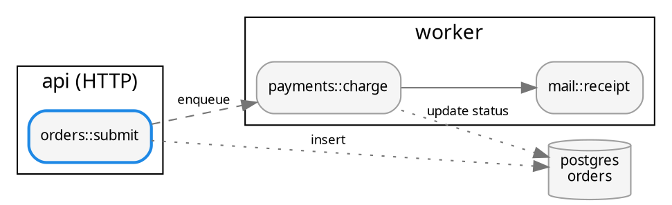

# Graphing a codebase

Two kinds of graph pay off when analysing a codebase:

1. **Generated structure** — module/package/crate dependencies. Let a tool emit DOT, then
   filter hard; a raw dependency dump of a real project is a hairball.
2. **Hand-written mechanism** — the 8–25 nodes that explain *how a request / build / job
   actually flows*, drawn from reading the code. This is usually the more useful one: name
   each node after the real function or file (`orders::submit`, `worker.ts:drain`) so the
   reader can open it.

## Tools that emit DOT

Checked 2026-10; flags change, confirm with `--help`.

| Ecosystem | Command |
|---|---|
| JS/TS | `npx madge --dot --extensions ts,tsx src/ > deps.gv` · `npx madge --circular src/` |
| JS/TS | `npx depcruise src --include-only '^src' --output-type dot > deps.gv` (`ddot` = folder level, `archi` = high level) |
| Python | `pydeps pkg --show-dot --no-output --max-bacon 2 > deps.gv` · classes: `pyreverse -o dot -p name pkg` (pylint) |
| Rust | `cargo depgraph --workspace-only` (crates) · `cargo modules dependencies --lib` (modules) |
| Go | `godepgraph -s ./cmd/app` · or `go mod graph` (pairs → `awk '{print "\""$1"\" -> \""$2"\""}'`) |
| Java/JVM | `jdeps -dotoutput out/ app.jar` · `mvn dependency:tree -DoutputType=dot -DoutputFile=deps.gv` |
| C/C++ | `cmake --graphviz=deps.gv -S . -B build` · Doxygen with `HAVE_DOT=YES CALL_GRAPH=YES` |
| Infra | `terraform graph` · `systemd-analyze dot` · `bazel query … --output graph` |

## Taming big graphs

Apply in this order; each step is a filter on DOT text, so chain them with pipes.

```bash
# 1. keep what matters (gvpr: == / != take shell patterns)
gvpr -c 'N[name != "src/*"]{delete($G, $)}' deps.gv > a.gv

# 2. cycles first — they are usually the finding
sccmap -S a.gv                      # prints only strongly connected components (import cycles)

# 3. drop edges implied by others: a->b->c makes a->c noise
tred a.gv > b.gv                    # warns "cycle involves edge …" but still works

# 4. spread wide fan-outs over several ranks
unflatten -l 3 -f b.gv > c.gv

# 5. render: dot for DAGs up to a few hundred nodes, sfdp beyond
dot -Tsvg c.gv -o deps.svg
sfdp -Goverlap=prism -Tsvg c.gv -o deps.svg
```

More levers:

- **Collapse to folders** — rename nodes to their directory before graphing (depcruise
  `ddot`, or rewrite ids with `sed`), then `strict digraph` merges duplicate edges.
- **Clusters by directory** — `subgraph cluster_api { … }` around each top-level package
  makes layering violations (edges going "up") obvious.
- **Highlight, don't hide** — keep context grey (`color="#cccccc"`) and draw the nodes under
  discussion in colour; a reader can see where they sit.
- `ccomps -x deps.gv` splits disconnected components into separate graphs — often several
  unrelated subsystems are hiding in one dump.
- `concentrate=true` merges parallel edges into trunks on dense DAGs.
- Over ~300 nodes a PNG in a terminal pane is unreadable whatever you do — render SVG and
  open it in a browser, or show the folder-level graph in the terminal.

## Hand-written mechanism graphs

When explaining how something works after reading the code:

- One node per function/component that matters; label `module::fn` or `file:fn`.
- Solid edges for calls, dashed for async/queued handoffs (`style=dashed, label="enqueue"`),
  dotted for data read/write against stores (`shape=cylinder`).
- Clusters for process or service boundaries — the edges crossing them are the interesting
  ones (network, IPC, threads).
- Mark the entry point (`shape=doublecircle` or bold) and the path under discussion
  (`penwidth=2`, colour); keep the rest grey.
- Keep it to one question per graph ("how does an order get paid?"), not the whole system.


