# DOT essentials

Reference: <https://graphviz.org/doc/info/lang.html> and
<https://graphviz.org/doc/info/attrs.html>. Checked against Graphviz 16.0 (2026-10).

## Skeleton worth copying

```dot
digraph flow {
  graph [rankdir=LR, fontname="Sans", fontsize=11, nodesep=0.3, ranksep=0.4, pad=0.1]
  node  [shape=box, style="rounded,filled", fillcolor="#f5f5f5", color="#9e9e9e",
         fontname="Sans", fontsize=10, margin="0.12,0.05"]
  edge  [color="#757575", arrowsize=0.7, fontname="Sans", fontsize=9]

  start [shape=circle, label="", width=0.15, fillcolor="#424242"]
  build [label="Build\nrelease"]
  done  [shape=doublecircle, label="", width=0.15, fillcolor="#424242"]

  start -> build -> done
}
```



## Ids and quoting

- Bare ids: letters, digits, `_` (not starting with a digit), or a plain number. Anything
  else — spaces, `-`, `.`, `/`, `:` — needs quotes: `"api-gateway"`, `"src/main.rs"`.
- `node`, `edge`, `graph`, `digraph`, `subgraph`, `strict` are keywords (case-insensitive):
  `node -> edge` is a syntax error; quote them or rename (`n_node`).
- `a:b` is **port syntax**, not an id with a colon. Quote it: `"a:b"`.
- Keep the id stable and short; put display text in `label=`.

## Attributes

- Lists are separated by `,` or `;` — or just whitespace: `[shape=box color=red]` is valid.
- Scope: `graph […]` / `node […]` / `edge […]` set defaults for what comes **after** them in
  the same (sub)graph. A later `a [color=red]` overrides an earlier one on the same node.
- `-G`, `-N`, `-E` on the command line set graph/node/edge attributes; `-Grankdir=LR`
  overrides the file.
- Label escapes: `\n` centred line break, `\l` left-justified, `\r` right; `\N` is the node
  id. Use `label=<…>` for HTML-like labels (below).

## Grouping and ranks

- **Clusters** draw a box only when the subgraph name starts with `cluster`:
  `subgraph cluster_build { label="Build"; … }`. Any other name groups attributes silently.
- `{ rank=same; a; b; c }` puts nodes on one rank (a row in TB, a column in LR). Combine with
  clusters only under `newrank=true` at graph level, otherwise rank=same inside a cluster is
  ignored or breaks layout.
- `edge [constraint=false]` (or per edge) draws an edge without letting it affect ranking —
  use it for back edges (retry loops) and cross-links that would otherwise drag nodes down.
- Invisible scaffolding: `a -> b [style=invis]` forces order without drawing.
- Edges between clusters: `compound=true` at graph level, then
  `x -> y [lhead=cluster_b, ltail=cluster_a]` clips the arrow at the cluster borders.

## Shapes worth knowing

`box`, `ellipse` (default), `circle`, `doublecircle` (final state), `point` (fork/join dot),
`diamond` (decision), `cylinder` (database), `note`, `folder`, `component`, `hexagon`,
`plaintext`/`none` (for HTML tables). `style` can combine: `"rounded,filled,dashed"`.

## HTML-like labels

For multi-field nodes prefer HTML tables over `shape=record` (records break with rankdir):

```dot
svc [shape=none, label=<
  <table border="0" cellborder="1" cellspacing="0" cellpadding="4">
    <tr><td bgcolor="#e3f2fd"><b>orders</b></td></tr>
    <tr><td port="api" align="left">POST /orders</td></tr>
    <tr><td port="db"  align="left">pg: orders</td></tr>
  </table>>]
svc:db -> postgres
```

## Edge routing

- `splines=true` (default curved), `ortho` (right angles; edge `label` is unsupported — use
  `xlabel`), `polyline`, `line`, `false`.
- `concentrate=true` merges parallel edges into shared trunks — big win on dense
  dependency graphs (`dot` only). It ignores edge style, so dashed failure edges get merged
  into solid flow edges; keep it to uniform graphs.
- `headport`/`tailport` (`n`, `s`, `e`, `w`, …) or `a:e -> b:w` pins where edges attach.

## Engines

| Engine | Use it for |
|---|---|
| `dot` | Hierarchies, flows, pipelines, dependency DAGs — the default choice |
| `neato` | Small undirected graphs (spring model); `-n2` = keep given positions |
| `fdp` | Undirected, supports clusters |
| `sfdp` | Large graphs (thousands of nodes); add `overlap=prism` |
| `circo` | Rings, cyclic structures |
| `twopi` | Radial trees around a `root=` node |
| `osage`, `patchwork` | Packed clusters / treemaps |

Select with the binary name (`sfdp g.gv`) or `dot -Ksfdp`.

## Output formats

`-Tpng` (terminal, chat), `-Tsvg` (zoomable, tooltips/links work), `-Tpdf`,
`-Tdot`/`-Txdot` (layout coordinates, for pinning), `-Tplain` (easy-to-parse positions),
`-Tjson`, `-Tkitty`, `-Tvt-24bit`. `dot -T?` lists all; `-O` auto-names output files.
