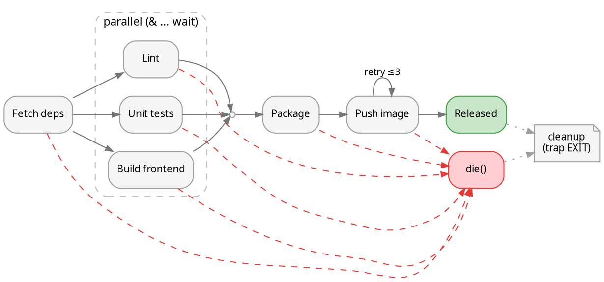

# Flows from scripts

The trigger: a `build.sh`, `deploy.sh`, `bootstrap.sh`, Makefile or CI workflow where the
real control flow — what runs in order, what runs in parallel, what happens on failure —
is buried in `echo "==> Step 3/7: …"` banners, header comments and `&`/`wait` pairs. One
diagram replaces a page of that prose, and makes missing joins or unhandled failures
visible.

## Extraction recipe

1. **Find the steps.** Read the script top to bottom, guided by:
   ```bash
   grep -nE '^\s*(echo|printf|log|info|step)\b|^\s*#{1,2} |&\s*$|\bwait\b|\|\||&&|set -e|trap ' script.sh
   ```
   One node per *phase* the banners announce, not per command. Six to twenty nodes is the
   readable range; more means clusters (below).
2. **Find the concurrency.** `cmd &` … `wait`, `xargs -P`, `parallel`, `make -j`,
   `docker compose up` (services), CI jobs without `needs:`.
3. **Find the exits.** `set -e`, `|| exit`, `|| die`, `trap … EXIT/ERR`, retry loops,
   `if ! …; then`.
4. **Write the DOT** with the mapping below; ids from the function or step name, labels from
   the banner text (shortened), extra explanation in `tooltip=` or a comment.
5. **Show it** — `scripts/dotcat flow.gv` in a kitty pane. If the script is going to be
   rewritten, the diagram is also a good place to agree the target flow first.

## Construct → DOT

| Script construct | DOT |
|---|---|
| `a; b` / `a && b` / successive banners | `a -> b` |
| `a & b & wait` | fork: `prev -> {a b}`; join: `{a b} -> join`; `{rank=same; a; b}` keeps them side by side |
| `wait` as a real barrier | `join [shape=point, width=0.08]` or a labelled node if it does work |
| `xargs -P4` / `parallel` over N items | one node `"build ×N\n(4 at a time)"` — don't draw N copies |
| `if …; then … else … fi` | `cond [shape=diamond]`, edges labelled `yes` / `no` |
| `set -e` / `\|\| exit 1` | dashed red edge from each step that can fail to one `fail` sink |
| `for i in 1..3; do … && break; sleep; done` (retry) | back edge `step -> step [label="retry ≤3", constraint=false]` |
| `trap cleanup EXIT` | `cleanup` node; dotted edges from the sinks (`done`, `fail`) into it |
| function called from several places | one node; don't duplicate it per call site |
| sourced file / sub-script | `subgraph cluster_<name>` around its steps |
| background service started then used (`server & … kill`) | node with `style="rounded,filled,dashed"` spanning the steps, dotted edge to the kill |

## Worked example

Script narrative (abridged): *"==> Fetching deps", then lint, unit tests and the frontend
build run in parallel (`&` … `wait`); "==> Packaging" retries the registry push three
times; any failure jumps to `die`; `trap cleanup EXIT` removes the temp dir.*



Notes on the choices: `strict` so a later restyle of an edge merges (handy if the same file
drives a [live view](live-updates.md)); failure edges use `constraint=false` so they don't
pull the main line out of shape, and `{rank=same; ok; fail}` parks the `fail` sink beside
the success end instead of at rank 0 (without it, `die()` and `cleanup` drift to the far
left); the cluster label states *how* the parallelism happens, which is what the banners
were trying to say. Leave `concentrate=true` off here: it would merge the dashed failure
edges into the flow edges ([dot-language.md](dot-language.md)).

## Build tools that already know the graph

Let the tool emit the edges instead of reading them off by hand:

| Tool | Command |
|---|---|
| Make | `make -Bnd \| make2graph \| dot -Tpng -o make.png` (`makefile2graph` package) |
| GitHub Actions | `needs:` → DOT with jq (below) |
| Docker Compose | `depends_on:` — same jq approach over `docker compose config --format json` |
| systemd | `systemd-analyze dot 'myapp*.service' \| dot -Tpng -o units.png` |
| Terraform | `terraform graph \| dot -Tpng -o tf.png` |
| Bazel | `bazel query 'deps(//app)' --output graph` |
| CMake | `cmake --graphviz=deps.dot -S . -B build` |

Two incompatible `yq`s exist: mikefarah's Go one (`yq -o=json file`) and the Python wrapper
around jq (`yq . file`; `yq --version` mentions jq). Either gives JSON for jq:

```bash
yq -o=json .github/workflows/ci.yml | jq -r '"digraph ci {",
  (.jobs | to_entries[] | .key as $j | "  \"\($j)\";",
    ((.value.needs // []) | if type == "string" then [.] else . end | .[] | "  \"\(.)\" -> \"\($j)\";")),
  "}"'
```

## Making the script draw itself

When the script will be run interactively and often, keep the `.gv` next to it and have it
report progress through `scripts/dotlive.sh`: same node ids as the diagram, `live_set
<step> running|done|failed` at each banner, step output to `$LIVE_LOG`. The banners stay
as the plain-text fallback outside a graphics terminal.
