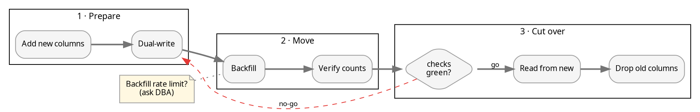

# Planning complex flows

Prose plans hide ordering mistakes: two steps that both "come after the migration", a
rollback that has no path back, a parallel branch nobody joins. Drawing the plan as a graph
before executing it surfaces those, and the same file later shows progress.

## Shape of a plan graph

- **Phases → clusters** (`subgraph cluster_p1 { label="1 · Prepare" }`), laid out in order.
- **Steps → boxes**; verbs in labels ("Backfill orders", not "Orders").
- **Decisions / gates → diamonds** with labelled outcomes (`go`, `no-go`). Every gate
  needs every outcome drawn — a missing `no-go` edge is a missing part of the plan.
- **Rollback → red dashed edges** back to a safe state, `constraint=false` so they don't
  reshape the forward flow.
- **Parallel work** → fan-out/join (`shape=point` join) — the join makes the dependency
  explicit ("deploy waits for *both* backfill and dual-write").
- **Open questions → `shape=note`** nodes attached with dotted edges to the step they block.
- **Critical path** → `penwidth=2` on its edges; everything else stays thin.

## Working with the plan

- Show it in a side pane (`scripts/dotcat plan.gv`); a `vsplit` pane next to the
  conversation gives TB, a wide `hsplit` strip gives LR ([orientation.md](orientation.md)).
- Iterate on the `.gv` like code: re-render after each change and look at what moved.
- When execution starts, keep node ids stable and drive colours from state
  ([live-updates.md](live-updates.md)) — the plan becomes the progress view.
- If the plan will be published to a docs site or PR description, port it to Mermaid there
  (`mermaid-diagrams` skill); keep Graphviz for the terminal.
